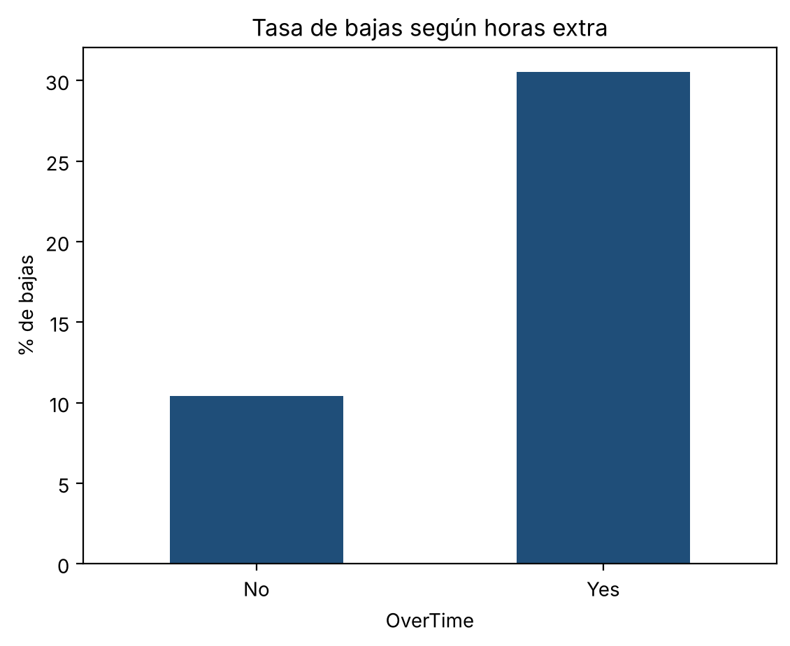
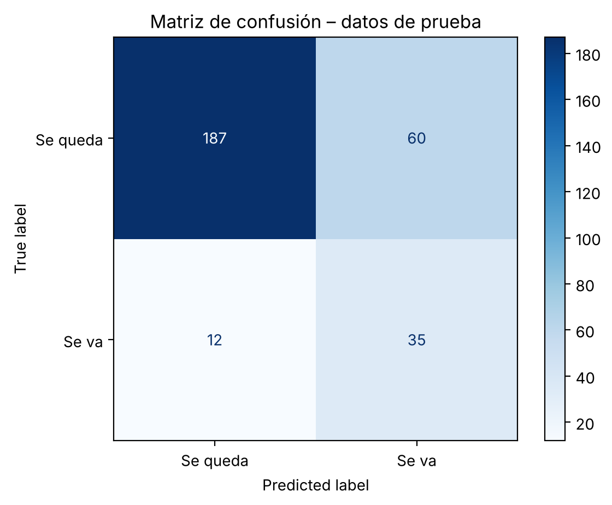

<h1 align="center">Predicción de bajas voluntarias de empleados</h1>

<p align="center">
  <b>Proyecto Integrador Final – Prácticas Profesionalizantes I</b><br>
  Tecnicatura Superior en Ciencia de Datos e Inteligencia Artificial – Instituto Nuevos Aires<br>
  Autor: Lucas Pérez Amador · Profesor: MSc. Ángel Daniel Fuentes S. · Noviembre 2026
</p>

<p align="center">
  
  
  
</p>

---

## Descripción

Proyecto profesional **simulado** en el que la Gerencia de Capital Humano de una empresa ficticia (*TechNova S.A.*) necesita anticipar qué empleados podrían renunciar. Se desarrolló un prototipo de **Red Neuronal Artificial** que estima la probabilidad de baja voluntaria, trabajando con **Scrum**, **Trello** y **GitHub**.

## Problema y objetivos

La empresa tiene una tasa de bajas del **16%** y RRHH se entera cuando la renuncia ya ocurrió.

- **Objetivo general:** desarrollar un prototipo que estime la probabilidad de baja de un empleado.
- **Objetivos específicos:** analizar los datos, prepararlos, entrenar y evaluar el modelo (meta: detectar al menos el 70% de las bajas) y documentar sus implicancias éticas.

Detalle completo (alcance, recursos, riesgos, entregables): [`docs/planificacion.md`](docs/planificacion.md)

## Equipo y roles

> Trabajo individual. Rol principal del autor: **Scrum Master**. Los demás roles son simulados y también los ejecuta el autor.

| Rol Scrum | Rol técnico |
|---|---|
| Product Owner | Gerente de Capital Humano (cliente) |
| Scrum Master **(autor)** | Líder del proyecto / facilitador |
| Equipo de desarrollo | Ingeniero de Datos · Científico de Datos · Analista BI |

## Metodología

- **Scrum:** Product Backlog con 12 historias de usuario priorizadas y estimadas, 2 sprints de 2 semanas con Planning, Daily, Review y Retrospective. Ver [`docs/sprints.md`](docs/sprints.md).
- **Gestión de conflictos:** se documentó un conflicto de tarea sobre el uso de variables sensibles, resuelto por colaboración.
- **Trello:** tablero con listas *Product Backlog → Sprint Backlog → En proceso → En revisión → Hecho*.
  🔗 **Tablero:** [trello.com/b/N82VJ8TJ](https://trello.com/b/N82VJ8TJ)
- **GitHub:** trabajo en la rama `desarrollo` e integración a `main` mediante Pull Request.

<p align="center"></p>

## Tecnologías

| Herramienta | Uso |
|---|---|
| Python, Jupyter Notebook | Desarrollo |
| pandas, NumPy | Manejo de datos |
| scikit-learn | División de datos, normalización y métricas |
| TensorFlow / Keras | Red neuronal |
| matplotlib | Gráficos |
| Git, GitHub, Trello, Canva | Control de versiones, gestión del trabajo y presentación |

## Estructura del repositorio

```
├── README.md
├── requirements.txt
├── data/empleados_ibm.csv          # Dataset (IBM HR Analytics, datos ficticios)
├── notebooks/prediccion_bajas.ipynb
├── modelo_bajas_entrenado.keras    # Modelo entrenado
├── img/                            # Gráficos y capturas
└── docs/
    ├── planificacion.md            # Problema, objetivos, roles, backlog, sprint planning, riesgos
    ├── sprints.md                  # Dailies, conflicto, reviews y retrospectivas
    └── etica.md                    # Informe de ética
```

## Cómo ejecutarlo

```bash
git clone https://github.com/Lucasplpa/Proyecto_final_INA-prediccion_bajas.git
cd Proyecto_final_INA-prediccion_bajas
pip install -r requirements.txt
jupyter notebook notebooks/prediccion_bajas.ipynb
```
Ejecutar las celdas en orden. Probado con Python 3.13 y TensorFlow 2.x.

## Resultados

| Métrica (datos de prueba, 294 empleados) | Valor |
|---|---|
| Exactitud (accuracy) | 75,5% |
| Bajas detectadas (recall) | 74% (35 de 47) |
| Falsas alarmas | 60 |

<p align="center">
  
  
</p>

- Los empleados con **horas extra** se van el triple (30,5% vs. 10,4%).
- El modelo cumple la meta de detectar más del 70% de las bajas, a costa de generar falsas alarmas. Por eso se usa como **alerta para conversar**, no como decisión.

## Presentación

Presentación final en Canva: [ver presentación](https://canva.link/r8wamuazr03loi7)

## Ética

Se excluyeron edad, género y estado civil; el modelo es de apoyo y no debe usarse para sancionar o despedir. Si se usaran datos reales aplica la Ley 25.326. Informe completo: [`docs/etica.md`](docs/etica.md)

## Conclusiones y aprendizajes

- Un proyecto de datos empieza por **entender el problema y planificar**, no por programar.
- Scrum, Trello y GitHub dan **transparencia**: cualquiera puede ver qué se hizo, cuándo y por qué.
- En datos desbalanceados la exactitud engaña; hay que mirar la matriz de confusión.
- Las decisiones técnicas también son decisiones **éticas**, y conviene documentarlas.

## Autor

**Lucas Pérez Amador** – Analista de People Analytics y estudiante de la Tecnicatura en Ciencia de Datos e IA. Experiencia en Power BI, BigQuery/GCP y Looker; interés en modelos predictivos aplicados a Recursos Humanos.

GitHub: [Lucasplpa](https://github.com/Lucasplpa)
